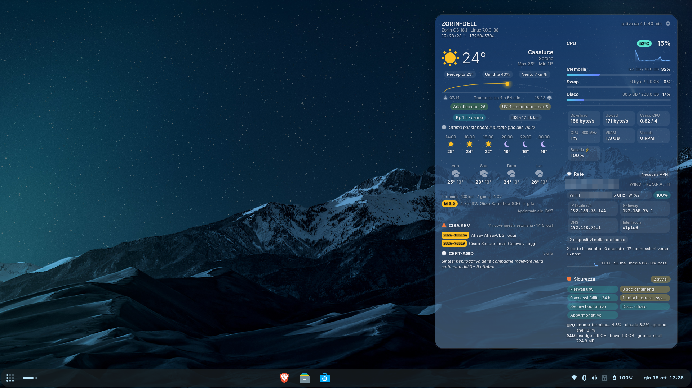
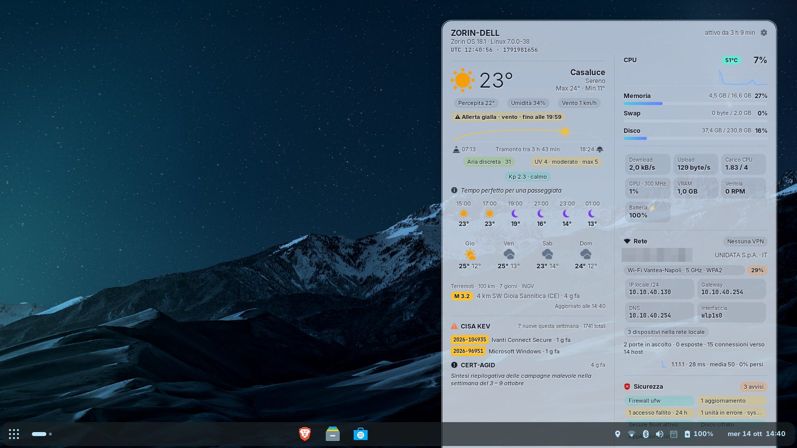
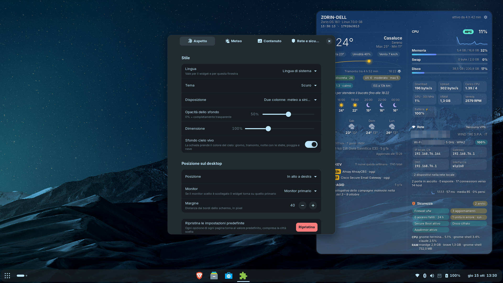

# Desktop System & Weather Widget

🇮🇹 [Versione italiana](README.md)

**What it does.** A GNOME Shell extension that draws a translucent card on the desktop
background, always below your windows, with three things at a glance: the state of your
computer (CPU, memory, disk, network, GPU, fans, battery), the weather where you are (current
conditions, next hours, forecast, official warnings, imminent rain, sun, moon, air quality, UV,
pollen) and a network and security panel (public IP and VPN, Wi-Fi, open ports, firewall,
pending updates, failed logins, CISA KEV vulnerabilities and CERT-AGID news). No API keys, no
extra programs and no administrator privileges: system data is read from `/proc`, `/sys` and
D-Bus. The interface is available in English and Italian. Compatible with **GNOME Shell 45–50**
on Zorin OS 18, Ubuntu 24.04+, Debian 13+, Fedora 39+ and others (see
[Compatibility](#compatibility)).

In detail, it shows:

- **System**: CPU usage with history graph, CPU temperature, load, GPU temperature, clock and
  used video memory (AMD, NVIDIA, Intel and other DRM drivers, no privileges needed), memory,
  swap, disk, network speed, load average, fans, battery with remaining time (or time to full
  charge), uptime
- **Weather**: current conditions, feels-like temperature, humidity, wind and a 4-day forecast
  with the rain probability of each day
  (data from [Open-Meteo](https://open-meteo.com), no API key required)
- **Next hours**: six two-hour slots with time, day/night icon, temperature and rain
  probability when it exceeds 20%
- **Weather warnings**: the yellow, orange and red warnings issued by the national weather
  service for your region, distributed by [MeteoAlarm](https://meteoalarm.org) (Italy and 16
  other European countries), with details on hover and a desktop notification for orange and
  red ones
- **Rain in the next two hours**: "Rain in 25 min · for ~45 min", with a mini bar in 15-minute
  steps (shown only when needed)
- **Sun and moon**: sun arc with the current position, sunrise and sunset times, time left to
  sunset; at night the moon phase computed locally and the days to the next full or new moon
- **Air, UV and pollen**: European air quality index, current and daily maximum UV index,
  dominant pollen (birch, grass, olive… available in Europe)
- **Tip of the day**: one practical line derived from the next hours ("Take an umbrella: rain
  likely from 18:00", "High UV around 13:00: sunscreen", "Great for hanging the laundry…")
- **Recent earthquakes**: the latest quake of the past 7 days within the chosen radius
  (data from [INGV](https://www.ingv.it) in Italy, USGS elsewhere)
- **Living sky background**: the card takes the colour of the real sky: blue by day, orange at
  dawn and dusk, night blue with stars, grey under rain, with drops or snowflakes
- **Space weather and ISS**: NOAA Kp index with geomagnetic storm and aurora alerts, current
  distance of the International Space Station ("ISS above you now · look up!")

And, for people working in IT or security, a **Network and security** panel read locally
without privileges (NetworkManager over D-Bus, `/proc`, `/sys`, systemd and login1 over D-Bus):

- **Network**: public IP with provider and country (can be masked for screenshots), VPN status
  with a warning when the VPN drops or the public IP changes, Wi-Fi with band and encryption
  (flags open, WEP and WPA1 networks), local IP, gateway, DNS and interface
- **Devices on the local network**: how many there are (from the ARP cache, without generating
  traffic), with IP and MAC in the hover panel and a warning when a new one appears
- **Ports and connections**: listening TCP ports, those exposed to the network listed by name
  (22 ssh, 631 ipp…), active connections and number of remote hosts
- **Latency**: graph of the TCP connect time to the chosen host (1.1.1.1 by default), average
  and percentage of lost probes
- **Security**: firewall (ufw, firewalld, nftables), pending and security updates (apt, pacman,
  dnf, zypper and Flatpak), reboot required (new kernel installed or requested by the
  distribution), failed logins in the last 24 hours, remote sessions and logged-in users, SSH
  server, failed systemd units, Secure Boot, LUKS disk encryption, AppArmor/SELinux, running
  Docker/Podman containers, with an "All good" or "N warnings" summary
- **Processes**: the three processes using the most CPU and the most memory
- **Feeds**: the latest actively exploited vulnerabilities from the
  [CISA KEV](https://www.cisa.gov/known-exploited-vulnerabilities-catalog) catalogue (ransomware
  ones highlighted) and the latest news from [CERT-AGID](https://cert-agid.gov.it), the Italian
  public-administration CERT
- **Details on hover**: resting the pointer on a security indicator, a CVE or a news item opens
  a panel with the details: the latest failed login attempts (time, service, user, source
  address), the packages to update and the date of the last update, failed units, open sessions,
  the SSH server configuration, containers with image and ports, what Secure Boot, encryption
  and AppArmor mean; for CVEs the description, required action, date added and CISA due date,
  for news the summary. Clicking a CVE or a news item opens it in the browser (NVD or CERT-AGID)
- **Desktop notifications** when the VPN drops, when five or more logins fail between two
  checks, for orange and red weather warnings and when CISA adds a ransomware-related
  vulnerability to the KEV catalogue (CVEs already seen are not repeated at login)
- **UTC clock and Unix time** below the computer name; every other time follows the 12 or
  24-hour format chosen in the GNOME settings
- **Terminal themes**: besides dark and light, two phosphor themes (green and amber) with a
  monospace font, block graphs and scanlines
- **Two columns**: weather and feeds on the left, system, network and security on the right
  (default), or a single column





## Features

| Setting | Options |
|---|---|
| Language | System language, English, Italiano (applies to the widget and the preferences) |
| Theme | Dark / Light / Green terminal / Amber terminal |
| Layout | One or two columns |
| Background opacity | 0–100% |
| Size | 70–160% |
| Position | top left / centre / right, centre, bottom left / centre / right |
| Monitor | primary, or a screen chosen by name (e.g. HDMI-1); falls back to the primary one when it is unplugged |
| Margin from the edges | in pixels |
| Living sky background | On / off (with the theme's fixed background) |
| Weather location | Automatic (system location services, otherwise IP) or a city searched by name |
| Units | Metric (°C, km/h) or imperial (°F, mph) |
| Earthquakes | Minimum magnitude and search radius in km |
| Sections | Every block can be hidden: weather warnings, next hours, rain, sun and moon, air, space weather, tip, forecast, earthquakes, system, processes, network, ports, latency, security, feeds… |
| Network | Latency host, refresh intervals, public IP mask |
| Security | Details on hover (on/off), check interval |
| Notifications | VPN dropped, burst of failed logins, orange and red weather warnings, new ransomware vulnerability (each one on/off) |
| Reset | Button on the Appearance page that restores every option to its default |

Preferences open from the **gear** at the top right of the widget (it appears when the mouse is
over the card), from the **Extensions** app, or with:

```bash
gnome-extensions prefs desktop-sysweather@piorio.github.io
```

## Compatibility

Requires **GNOME Shell 45 to 50** (Wayland or X11 session). Linux distributions shipping it:

| Distribution | Versions | GNOME Shell | Status |
|---|---|---|---|
| Zorin OS | 18 Core / Pro | 46 | **Tested** (Zorin OS 18.1) |
| Ubuntu | 24.04 LTS, 24.10, 25.04, 25.10, 26.04 LTS | 46–50 | Should work (same base as Zorin 18) |
| Debian | 13 "trixie" and later | 48+ | Should work |
| Fedora Workstation | 39 and later | 45+ | Should work; `dnf` update check not verified on a real machine |
| openSUSE Tumbleweed / Leap 16 | current | 45+ | Should work; `zypper` update check not verified |
| Arch Linux, Manjaro GNOME, EndeavourOS | rolling | 45+ | Should work (updates via `checkupdates` from pacman-contrib) |
| Pop!_OS, Linux Mint | all | — | **No**: they use COSMIC/Cinnamon, not GNOME Shell |

- The `.deb` package is for Zorin OS, Ubuntu, Debian and derivatives; on other distributions use
  the `.zip` with `install.sh` or `gnome-extensions install`.
- It does not work on desktops other than GNOME (KDE Plasma, XFCE/Zorin Lite, Cinnamon, MATE,
  COSMIC) nor on GNOME Shell 44 and earlier.
- Weather warnings cover Italy, France, Spain, Germany, Austria, Switzerland, the United Kingdom,
  Portugal, Greece, the Netherlands, Belgium, Croatia, Slovenia, Malta, Ireland, Poland and
  Czechia (MeteoAlarm feeds); earthquakes use INGV in Italy and USGS elsewhere.

The widget is drawn in the GNOME Shell background layer: it stays below every window and does
not show up in Alt+Tab. It reads its data directly from `/proc`, `/sys` and D-Bus, so no extra
programs or privileges are needed. The details panel and the gear are drawn above the windows
only while the pointer is over the card, because the background layer receives no mouse events.
Failed logins require a readable journal (`adm` or `systemd-journal` group, the default on
Zorin/Ubuntu); updates use update-notifier's `apt-check` where present, otherwise
`checkupdates` (Arch), `dnf` (Fedora, from the already downloaded metadata) or `zypper`
(openSUSE), plus `flatpak remote-ls --updates`. External services used: Open-Meteo, Nominatim,
MeteoAlarm, INGV/USGS, ipwho.is (public IP), CISA, CERT-AGID, NOAA SWPC, wheretheiss.at.

## Installation

Ready-made packages (`.deb` and `.zip`) can be downloaded from the
[Releases](https://github.com/gigix21288/desktop-sysweather/releases) page; alternatively build
them from source with `./build.py` (see [Development](#development)).

### .deb package (Zorin OS, Ubuntu, Debian)

```bash
sudo apt install ./gnome-shell-extension-desktop-sysweather_1.6.0_all.deb
```

Then **log out and back in** and enable the widget from the *Extensions* app, or with
`gnome-extensions enable desktop-sysweather@piorio.github.io`.

### .zip package (any distribution with GNOME, current user only)

```bash
./install.sh desktop-sysweather@piorio.github.io.shell-extension.zip
```

The script installs and enables the extension. On Wayland you then need to log out and back in.

### Uninstall

```bash
gnome-extensions uninstall desktop-sysweather@piorio.github.io   # .zip version
sudo apt remove gnome-shell-extension-desktop-sysweather          # .deb version
```

## Automatic location

With the **Automatic** location the widget first asks the **system location services**
(GeoClue, the same service used by GNOME Weather): this works when the switch in
*Settings → Privacy → Location Services* is on. GeoClue uses GPS or a modem when available,
otherwise nearby Wi-Fi networks (BeaconDB database); if the surrounding networks are not
catalogued it falls back to the IP address and accuracy drops to tens of km (the widget shows
this in the status line, e.g. "system location ±26 km").

If location services are off or GeoClue is not installed, the position is estimated from the IP
address as before. The place name comes from OpenStreetMap (Nominatim).

## Privacy

- The system location stays on the computer: the widget only receives the coordinates.
- The IP-based estimate uses `ipwho.is` (with `get.geojs.io` as a fallback), at most once every
  3 hours.
- Forecast, air quality and city search use Open-Meteo; the place name Nominatim
  (OpenStreetMap); earthquakes INGV or USGS. All of them only receive rounded coordinates.
- With a manually set city no geolocation service is contacted (a city chosen with a version
  earlier than 1.5 is looked up once on Open-Meteo to get its region and country, then the
  result stays in the settings).
- For weather warnings the MeteoAlarm feed of the whole country is downloaded and the region
  filter runs on the computer: MeteoAlarm never receives any coordinates.

## Development

```
extension/            extension sources (ESM, GNOME 45+)
  extension.js        lifecycle, timers, positioning
  prefs.js            preferences window (libadwaita)
  lib/system.js       /proc and /sys readers (asynchronous)
  lib/weather.js      Open-Meteo (weather, air), IP geolocation, Nominatim, INGV/USGS
  lib/geoclue.js      position from the system location services (GeoClue 2)
  lib/sky.js          pure computations: sun, moon, sky colours, 15-minute rain, tip
  lib/widget.js       user interface (St + Cairo) and the texts of the detail panels
  lib/security.js     local security state (apt, journal, systemd, login1, /sys)
  lib/feeds.js        CISA KEV, CERT-AGID, NOAA, ISS, MeteoAlarm, public IP
  stylesheet.css      dark and light themes
po/                   translations (it)
build.py              builds dist/*.zip and dist/*.deb
install.sh            per-user installation from the .zip
tools/                msgfmt.py (fallback .po compiler), nested-shell.sh (testing)
CHANGELOG.md          version history
```

```bash
./build.py            # builds zip and deb in dist/
./build.py zip        # zip only
```

The build needs `python3` and `glib-compile-schemas`, plus `dpkg-deb` to create the `.deb`.
If `msgfmt` is not installed, `tools/msgfmt.py` is used instead.

To try a change without logging out (Wayland reloads extensions only at login) you can run a
nested GNOME Shell with the extension installed:

```bash
./build.py zip && gnome-extensions install --force dist/*.zip
tools/nested-shell.sh 40 /tmp/widget.png     # starts the nested shell and saves a screenshot
RUN="gnome-extensions prefs desktop-sysweather@piorio.github.io" tools/nested-shell.sh 40 /tmp/prefs.png
```

The nested shell shares its settings (dconf) with the real session; `tools/nested-shell.sh`
accepts a third argument with a JavaScript file to run inside the shell (`org.gnome.Shell.Eval`).

To add a language, copy `po/it.po` to `po/<code>.po` and translate the `msgstr` strings (and
the `msgstr[0]`/`msgstr[1]` plural forms): after the build the language shows up by itself in
the *Language* menu of the preferences. Source strings are in English, so English is always
available. With *System language* gettext is used; with a chosen language the widget reads the
`.mo` catalogue directly (`lib/i18n.js`), because gettext cannot switch language at runtime.

## License

GNU General Public License, version 2 or later (GPL-2.0-or-later), as required for extensions
published on extensions.gnome.org. The full text is in the `LICENSE` file.
